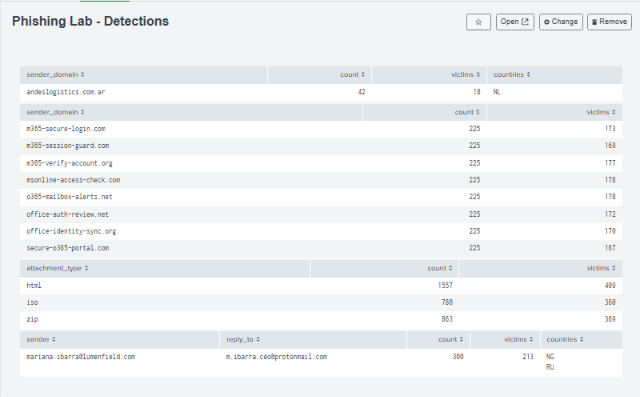

# email-threat-hunting-soar-lab
End-to-end SOC lab on 99,042 emails: threat hunting with SQL, a Python risk-scoring engine, Splunk detections, a Shuffle SOAR playbook and an incident report. Focuses on detecting credential phishing, malware attachments, Business Email Compromise (BEC) and CEO impersonation.

# SOC Investigation & Threat Hunting: Email Phishing & BEC Analysis

## 1. Executive Summary
During proactive threat hunting operations, an investigation was conducted on **99,042 email gateway logs** (October 2026) from **Lumenfield**, a fictional company with ~420 employees in Córdoba, Argentina. The objective was to find attack campaigns missed by the current email filter, measure its false negatives and false positives, and build detections and automated responses.

The hunt identified **4 malicious campaigns** and **1 benign false-positive pattern**. The current filter delivered **3,027 malicious emails** to inboxes, including **100% of a BEC campaign** sent from a compromised supplier account. The risk-scoring engine reduced attacks delivered without review to **0**, with **0 legitimate emails blocked**.

| Campaign | Emails | Victims | Filter Missed |
| :--- | :--- | :--- | :--- |
| **Credential Phishing** (8 rotating domains) | 1,800 | 414 | 1,546 (86%) |
| **Malware** (HTML / ZIP / ISO attachments) | 3,200 | 421 | 1,285 (40%) |
| **BEC** (compromised supplier) | 42 | 18 (finance) | **42 (100%)** |
| **CEO Impersonation** (gift card fraud) | 300 | 213 | 154 (51%) |
| **Newsletter Spikes** (benign) | 8,189 | N/A | N/A |

> All companies, people, domains and IPs are fictional or illustrative. Attachments are harmless placeholders and threat-intelligence data is simulated.

---

## 2. MITRE ATT&CK Mapping

| Tactic | Technique ID | Technique Name | Details |
| :--- | :--- | :--- | :--- |
| **Initial Access** | `T1566.002` | Phishing: Spearphishing Link | Fake Microsoft 365 login pages sent from newly registered domains. |
| **Initial Access** | `T1566.001` | Phishing: Spearphishing Attachment | Invoices delivered as .html, .zip and .iso attachments. |
| **Defense Evasion** | `T1027.006` | HTML Smuggling | HTML attachments used to bypass attachment scanning. |
| **Resource Development** | `T1583.001` | Acquire Infrastructure: Domains | A new phishing domain registered every day (domain rotation). |
| **Resource Development** | `T1585.002` | Establish Accounts: Email Accounts | Throwaway freemail senders (gmail, yahoo, hotmail, outlook). |
| **Resource Development** | `T1586.002` | Compromise Accounts: Email Accounts | A real supplier mailbox used to send the BEC emails. |
| **Defense Evasion** | `T1656` | Impersonation | Posing as the CEO and as a trusted supplier. |
| **Impact** | `T1657` | Financial Theft | Requests to change bank details and to buy gift cards. |

---

## 3. Investigation & Threat Hunting (SQL Queries)

### 3.1 Baseline
```sql
SELECT filter_verdict, COUNT(*) AS total
FROM emails
GROUP BY filter_verdict
ORDER BY total DESC;
```

**Findings:** The filter marked **89,034 emails as clean (90%)**, **8,093 as spam** and **1,915 as quarantine**. **8,586 emails failed DMARC**. Every campaign below was compared against the filter's verdict to measure false negatives.

---

### 3.2 Identifying Volume Spikes (False-Positive Pattern)
```sql
SELECT substr(timestamp, 1, 10) AS day, COUNT(*) AS total
FROM emails
GROUP BY day
ORDER BY total DESC
LIMIT 10;
```

**Findings:** Four days stood out: **October 7, 14, 21 and 28**, all Wednesdays (**4,696 to 5,283 emails** each). Investigation reveals scheduled newsletters from **club-lumen-benefits.com**, **mercadolibre.com.ar** and **techdigest-weekly.com**, with the same subject every week and SPF/DKIM/DMARC passing. This is a **False Positive**: a volume-based rule would flag legitimate newsletters.

---

### 3.3 Identifying Credential Phishing (Brand Impersonation)
```sql
SELECT sender_domain, COUNT(*) AS emails,
       COUNT(DISTINCT recipient) AS victims,
       MIN(timestamp) AS first_seen, MAX(timestamp) AS last_seen,
       SUM(filter_verdict = 'clean') AS delivered
FROM emails
WHERE display_name LIKE '%Microsoft%'
  AND sender_domain NOT LIKE '%microsoft.com'
GROUP BY sender_domain
ORDER BY first_seen;
```

**Findings:** **Eight domains** (m365-secure-login.com, office-auth-review.net, m365-verify-account.org and five more) used the display name **"Microsoft 365 Security"**. Each sent exactly **225 emails over 3 days**, and a new domain started every day from **October 5 to 14**. The domains were **1 day old**. This is a **low-and-slow domain rotation** technique: no single domain sends enough volume to trigger reputation rules. The filter delivered **1,546 of 1,800 emails (86%)**.

---

### 3.4 Identifying Malware Delivery (Risky Attachments)
```sql
SELECT attachment_type, COUNT(*) AS emails,
       COUNT(DISTINCT recipient) AS victims,
       COUNT(DISTINCT sender_domain) AS sender_domains,
       SUM(filter_verdict = 'clean') AS delivered
FROM emails
WHERE attachment_type IN ('html', 'zip', 'iso')
GROUP BY attachment_type;
```

**Findings:** **3,200 emails** carried **.html (1,557)**, **.zip (863)** or **.iso (780)** attachments disguised as invoices, sent from **449 different domains** (freemail accounts and throwaway invoices-XXX.top domains). Because the senders can't be blocked one by one, detection relies on the **attachment type, not the sender**. The filter delivered **1,285 of them (40%)**, reaching all **421 employees**.

---

### 3.5 Identifying Business Email Compromise (Behavioral Anomaly)
```sql
SELECT sender, COUNT(*) AS emails,
       COUNT(DISTINCT recipient) AS victims,
       COUNT(DISTINCT sender_ip) AS ips,
       MIN(timestamp) AS first_seen, MAX(timestamp) AS last_seen,
       SUM(filter_verdict = 'clean') AS delivered
FROM emails
WHERE sender_domain = 'andeslogistics.com.ar'
  AND sender_country != 'AR'
GROUP BY sender;
```

**Findings:** The supplier **andeslogistics.com.ar** sent **1,818 emails from Argentina** during the month. Between **October 22 and 25**, **42 emails** from **laura.gomez@andeslogistics.com.ar** came from the **Netherlands**, always between **02:00 and 05:00**, from **36 different IPs**, all asking to change bank or payment details. They targeted **18 finance employees**. The emails passed SPF, DKIM and DMARC because the **real supplier mailbox was compromised**. The filter delivered **100%** of them. This is the highest-risk finding because of its direct financial impact.

---

### 3.6 Identifying CEO Impersonation (Spoofed Internal Domain)
```sql
SELECT sender, reply_to, sender_country, COUNT(*) AS emails,
       COUNT(DISTINCT recipient) AS victims,
       SUM(filter_verdict = 'clean') AS delivered
FROM emails
WHERE sender_domain = 'lumenfield.com'
  AND dmarc = 'fail'
GROUP BY sender, reply_to, sender_country;
```

**Findings:** **300 emails** used the CEO's address (**mariana.ibarra@lumenfield.com**) but **failed DMARC**, came from **Nigeria (157)** and **Russia (143)**, and redirected all replies to **m.ibarra.ceo@protonmail.com**. They asked employees for gift cards. **Root cause:** Lumenfield's DMARC policy is `p=none`, so emails that fail DMARC for its own domain are still delivered (**154 of 300, 51%**).

---

## 4. Detection Engineering: Risk-Scoring Engine (Python)

Each email receives points for every signal that fires. The total decides the action: **≥ 45 block**, **20–44 analyst review**, **< 20 allow**.

| Signal | Level | Points |
| :--- | :--- | :--- |
| `reply_to_mismatch`, `dmarc_fail`, `risky_attachment` | **Strong** | 35 |
| `new_domain` (< 30 days), `whois_privacy`, `payment_keywords` | **Medium** | 20 |
| `night_hour` (00:00–05:59) | **Weak** | 10 |

| Result | Initial Weights | Tuned Weights (+ `payment_keywords`) |
| :--- | :--- | :--- |
| **Attacks allowed without review** | **30** (all BEC) | **0** |
| **Legitimate emails blocked** | 0 | 0 |
| **Malware auto-blocked** | 692 | 1,521 |

**Findings:** Validation against ground truth showed that domain-based signals alone could not catch the BEC campaign: the supplier domain was old, authenticated and had public WHOIS, so only `night_hour` fired (score 10, allow). A `payment_keywords` signal was added. Generic words like "invoice" were rejected because they matched **4,852 legitimate emails**; words describing a **change of payment destination** ("bank details", "remittance", "payment details") matched **42 of 42 BEC emails and 0 legitimate ones**. The new-but-legitimate domain **lumenfield-eventos.com** is routed to analyst review instead of being blocked.

Code: [`src/enrich_score.py`](src/enrich_score.py)

---

## 5. SIEM Detections (Splunk SPL)

### 5.1 PHISH-01: BEC from a Compromised Supplier
```spl
index=phishing (subject="*bank details*" OR subject="*remittance*" OR subject="*payment details*") sender_domain="*.com.ar" sender_country!=AR
| stats count dc(recipient) AS victims values(sender_country) AS countries by sender_domain
```

**Findings:** Payment keywords alone returned **1,082 hits**, mostly malware from freemail senders. Adding the behavioral condition (an Argentine domain sending from outside Argentina) isolated **exactly the 42 BEC emails with zero noise**. Each keyword was validated against known data: removing "payment details" drops **14 of the 42 emails**.

---

### 5.2 PHISH-02: Credential Phishing via Brand Impersonation
```spl
index=phishing display_name="*Microsoft*" sender_domain!="*microsoft.com"
| stats count dc(recipient) AS victims by sender_domain
| sort - count
```

**Findings:** **8 domains × 225 emails = 1,800**. Legitimate mail from **accountprotection.microsoft.com** is excluded by the domain condition.

---

### 5.3 PHISH-03: Malware Attachments
```spl
index=phishing attachment_type IN ("html", "zip", "iso")
| stats count dc(recipient) AS victims by attachment_type
```

**Findings:** **html 1,557**, **zip 863**, **iso 780**. No legitimate emails use these types in this environment.

---

### 5.4 PHISH-04: CEO Spoof (DMARC Fail on Own Domain)
```spl
index=phishing sender_domain=lumenfield.com dmarc=fail
| stats count dc(recipient) AS victims values(sender_country) AS countries by sender reply_to
```

**Findings:** A single line: the CEO's address, **300 emails**, **213 victims**, sent from **NG and RU**, replies redirected to **ProtonMail**. A related search showed **947 DMARC-failed emails delivered as clean** across all senders, consistent with the `p=none` policy.



---

## 6. Automated Response (Shuffle SOAR)

```
Webhook (Splunk alert) → Python scoring → condition → Block + warn finance
                                                    → Analyst review
                                                    → Allow + log
```

| Test Case | Score | Path |
| :--- | :--- | :--- |
| **BEC** from compromised supplier (NL, external Reply-To, 04:35) | 100 | Block + warn finance not to pay |
| **Real supplier** changing bank details (AR, office hours) | 20 | Analyst review: verify by phone |
| **Normal** event invitation | 0 | Allow + log |

**Findings:** All three branches were tested and only the matching branch ran each time. A legitimate bank-detail change is routed to a human instead of being blocked, because suppliers do change bank accounts and the right control is **out-of-band verification by phone**.


---

## 7. False Positives Identified

| Sender | Emails Blocked by the Filter | Why It's Legitimate |
| :--- | :--- | :--- |
| **lumenfield-eventos.com** | 209 | Real HR event invitation; domain only 9 days old, but authentication passes and no other red flags |
| **techdigest-weekly.com** | 58 | Established newsletter |
| **club-lumen-benefits.com** | 52 | Established newsletter |
| **mercadolibre.com.ar** | 46 | Established newsletter |

**Findings:** The filter judged senders by one signal at a time (domain age or volume). Blocking decisions require several signals combined.

---

## 8. Recommendations
- **Finance:** no bank-detail change accepted by email; always confirm by phone using a number already on file.
- **DMARC:** move lumenfield.com from `p=none` to `p=quarantine`, then `p=reject` after monitoring.
- **Detection:** deploy PHISH-01 to PHISH-04 and the SOAR playbook; build per-supplier baselines (usual country, hours, topics).
- **Email gateway:** block .iso and .html attachments from external senders; add an "External sender" banner.
- **People:** BEC and gift-card fraud awareness for finance; follow up on user reports (one employee reported a BEC email on day 2 and no action was taken).

Full incident report: [`docs/incident_report_bec.md`](docs/incident_report_bec.md) · All findings: [`docs/findings.md`](docs/findings.md)

---

## 9. Lab Environment
- **Splunk Enterprise** (Free license) on an Ubuntu VM in VirtualBox. Scheduled alerts require an Enterprise license, so detections are saved as reports and alerts were sent to the SOAR webhook manually.
- **Shuffle SOAR** (cloud). Response actions are simulated; in production they would call Microsoft 365, email and ticketing APIs.
- Scoring weights were set by analyst judgment and validated against ground truth.

---

## Repository Structure
```
email-threat-hunting-soar-lab/
├── data/        # 99,042-email log (zipped), 10 .eml samples, simulated threat intel
├── src/         # parse_eml.py (Phase 1), enrich_score.py (Phase 3)
├── queries/     # 01–07 SQL hunts + splunk/ detections (PHISH-01 to 04)
├── soar/        # Shuffle playbook export
└── docs/        # findings, incident report, screenshots
```

> **Note:** unzip `data/emails_30d.zip` before running the scripts (the CSV is 27 MB, over GitHub's upload limit).

**Tools:** Python · SQL (SQLite) · Splunk Enterprise · Shuffle SOAR · VirtualBox (Ubuntu)

**Author:** Alejandro José Vargas · CompTIA Security+ · Blue Team Level 1 (BTL1)
