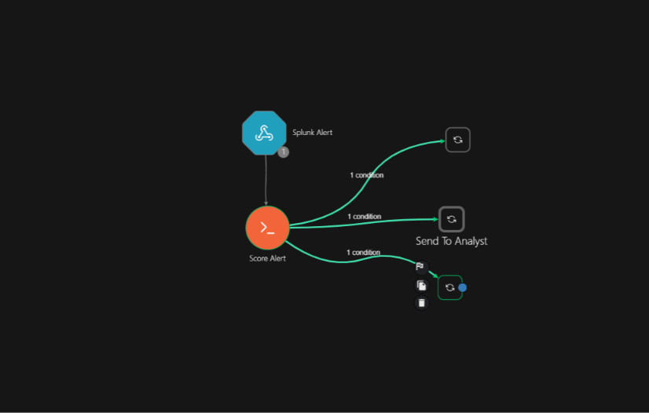

# Email Threat Hunting & Phishing Triage Lab

I took 30 days of email gateway logs (99,042 emails) from a fictional company, Lumenfield, and looked for attacks the spam filter had missed. I found four campaigns, wrote a Python script that scores every email, built Splunk detections for each campaign, automated the response with a Shuffle SOAR playbook, and wrote an incident report for the most serious case (a BEC).

**Tools:** Python, SQL (SQLite), Splunk Enterprise, Shuffle SOAR, VirtualBox (Ubuntu).
**Data:** simulated: all companies, people, domains and IPs are fictional. Unzip `data/emails_30d.zip` before running anything (the CSV is 27 MB, over GitHub's upload limit).

---

## What I found

| Campaign | Emails | People reached | Delivered by the filter |
| :--- | :--- | :--- | :--- |
| Credential phishing (fake Microsoft 365 login, 8 rotating domains) | 1,800 | 414 | 1,546 (86%) |
| Malware in HTML / ZIP / ISO attachments | 3,200 | 421 | 1,285 (40%) |
| **BEC from a real supplier's hacked mailbox** | 42 | 18 (finance) | **42 (100%)** |
| CEO impersonation asking for gift cards | 300 | 213 | 154 (51%) |
| Wednesday newsletter spikes | 8,189 | | Not an attack |

In total the filter delivered **3,027 malicious emails**. It also blocked **365 legitimate ones** (an HR event invitation and three newsletters).

---

## 1. Hunting with SQL

All queries are in [`queries/`](queries/) with their results at the bottom of each file.

**Baseline first.** Before hunting I checked what the filter had decided: 89,034 clean (90%), 8,093 spam, 1,915 quarantine, and 8,586 emails failing DMARC.

**Volume spikes → newsletters, not an attack.** Four days had ~5,000 emails each: October 7, 14, 21 and 28, all Wednesdays. They were scheduled newsletters (same subject every week, authentication passing). A rule like "too many emails = attack" would have flagged them.

**Credential phishing.** Eight domains used the display name "Microsoft 365 Security" without being microsoft.com. Each one sent exactly 225 emails over 3 days, and a new one started every day from Oct 5 to 14. The domains were 1 day old. Spreading the volume like this keeps each domain under reputation thresholds.

```sql
SELECT sender_domain, COUNT(*) AS emails, COUNT(DISTINCT recipient) AS victims,
       MIN(timestamp) AS first_seen, SUM(filter_verdict = 'clean') AS delivered
FROM emails
WHERE display_name LIKE '%Microsoft%' AND sender_domain NOT LIKE '%microsoft.com'
GROUP BY sender_domain
ORDER BY first_seen;
```

**Malware.** 3,200 emails with .html (1,557), .zip (863) or .iso (780) attachments, sent from 449 different domains (mostly free webmail). The senders change all the time, so the only stable signal is the attachment type.

**BEC (the most serious one).** The supplier `andeslogistics.com.ar` normally sends from Argentina. Between Oct 22 and 25, **42 emails** from `laura.gomez@andeslogistics.com.ar` came from the **Netherlands**, between **02:00 and 05:00**, from **36 different IPs**, all asking to change the bank account for payments. They passed SPF, DKIM and DMARC because the mailbox itself was compromised, so the filter let all of them through.

```sql
SELECT sender, COUNT(*) AS emails, COUNT(DISTINCT recipient) AS victims,
       COUNT(DISTINCT sender_ip) AS ips, SUM(filter_verdict = 'clean') AS delivered
FROM emails
WHERE sender_domain = 'andeslogistics.com.ar' AND sender_country != 'AR'
GROUP BY sender;
```

**CEO impersonation.** 300 emails used the CEO's address (`mariana.ibarra@lumenfield.com`) but failed DMARC, came from Nigeria and Russia, and had replies redirected to a ProtonMail address. They still got through because Lumenfield's DMARC policy is `p=none`.

Details for every campaign: [`docs/findings.md`](docs/findings.md)

---

## 2. Scoring every email (Python)

[`src/enrich_score.py`](src/enrich_score.py) gives each email points for each warning sign, then decides: **block** (≥ 45), **send to an analyst** (20–44) or **allow** (< 20).

| Signal | Points |
| :--- | :--- |
| Reply-To goes to a different domain, DMARC fails, risky attachment | 35 each |
| Domain younger than 30 days, hidden WHOIS owner, payment-change words in the subject | 20 each |
| Sent between 00:00 and 05:59 | 10 |

I checked the results against the known answers (`data/threat_intel/ground_truth.csv`). With my first set of signals, **30 of the 42 BEC emails were still allowed**: the supplier's domain was old and authenticated, so only the night-time signal fired. I added the `payment_keywords` signal. Generic words like "invoice" didn't work (they matched 4,852 normal emails), but "bank details", "remittance" and "payment details" matched all 42 BEC emails and no legitimate ones.

| | Before | After adding `payment_keywords` |
| :--- | :--- | :--- |
| Attacks allowed without review | 30 | **0** |
| Legitimate emails blocked | 0 | **0** |
| Malware blocked automatically | 692 | 1,521 |

I gave `payment_keywords` 20 points, not 35, on purpose: real suppliers do change bank accounts sometimes, so those emails should go to a person who can confirm by phone, not be blocked automatically.

---

## 3. Splunk detections

Loaded the CSV into an index called `phishing` (99,042 events, same count as Python). The four searches are in [`queries/splunk/`](queries/splunk/).

| ID | What it looks for | Hits |
| :--- | :--- | :--- |
| PHISH-01 | Payment-change words + `.com.ar` domain sending from outside Argentina | 42 (only the BEC) |
| PHISH-02 | Display name says "Microsoft" but the domain isn't microsoft.com | 1,800 |
| PHISH-03 | `.html`, `.zip` or `.iso` attachments | 3,200 |
| PHISH-04 | Our own domain failing DMARC | 300 |

For PHISH-01, the keywords alone returned 1,082 emails (mostly the malware campaign). Adding the country condition brought it down to exactly the 42 BEC emails. While testing, I also noticed that leaving out "payment details" dropped 14 of them, so each keyword is needed.

```spl
index=phishing (subject="*bank details*" OR subject="*remittance*" OR subject="*payment details*")
  sender_domain="*.com.ar" sender_country!=AR
| stats count dc(recipient) AS victims values(sender_country) AS countries by sender_domain
```


Splunk Free can't schedule searches or send alerts, so the detections are saved as reports.

---

## 4. Automated response (Shuffle SOAR)

```
Webhook (alert) → Python scoring → decision → Block + warn finance
                                            → Send to analyst
                                            → Allow + log
```

The Python step reuses the scoring logic above, plus the "supplier sending from an unusual country" check from PHISH-01. I tested all three paths:

| Test alert | Score | Path taken |
| :--- | :--- | :--- |
| The BEC (Netherlands, external Reply-To, 04:35) | 100 | Block + tell finance not to pay |
| A real supplier changing bank details (Argentina, office hours) | 20 | Analyst: confirm by phone |
| A normal event invitation | 0 | Allow |

The workflow export is in [`soar/`](soar/) (webhook URL removed). The actions are simulated messages; in a real company they would call the email platform and a ticketing system.



---

## 5. Incident report

[`docs/incident_report_bec.md`](docs/incident_report_bec.md): timeline, impact, root cause, IOCs and recommendations for the BEC. One detail I found while writing it: an employee reported one of the BEC emails on the second day, and nothing was done.

---

## Recommendations

- **Finance:** never accept a bank-detail change by email alone; call the supplier on a number already on file.
- **DMARC:** move lumenfield.com from `p=none` to `p=quarantine`, then `p=reject`.
- **Email gateway:** block `.iso` and `.html` attachments from outside; add an "External sender" banner.
- **SOC:** follow up on user-reported emails.

---

## Repository

```
data/       emails (zipped), 10 .eml samples, simulated threat intel + ground truth
src/        parse_eml.py (reads raw .eml files), enrich_score.py (scoring)
queries/    01–07 SQL hunts, splunk/ detections
soar/       Shuffle workflow export
docs/       findings, incident report, screenshots
```

**Author:** Alejandro José Vargas
